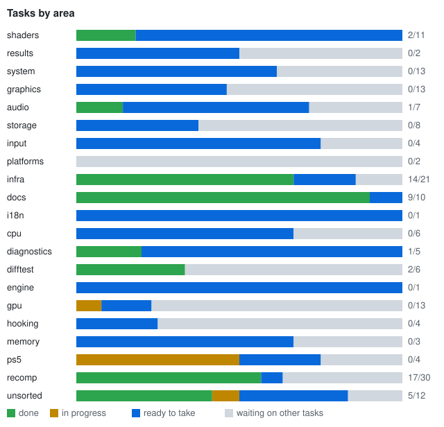

# Progress

Generated 2026-11-27 21:37 UTC from the task board by `tools/progress.py`. Do not edit by hand.

**51 of 174 tasks done** `██████··············` · 3 in progress · 60 ready to take · 60 waiting on others · 48 pull requests merged by 1 contributors

Legend: ✅ done · 🔨 in progress · 🟦 ready to take · ⏳ waiting on other tasks

## Phases

| Phase | What it means | Progress | Done |
|---|---|---|---:|
| 0. Foundation | the bot, the rules and the docs that let anyone join | `██████████` | 9/9 |
| 1. Shared knowledge | tests that define correct behaviour, checked on real hardware | `█·········` | 2/19 |
| 2. Adapters | running other projects' translators against those tests | `██········` | 1/6 |
| 3. Upstream fixes | fixing what the tests find, in the projects themselves | `··········` | 0/0 |
| 4. Shared components | pieces several projects need and nobody has yet | `██████████` | 1/1 |
| engine. Engine track | the hybrid recompiler itself, from loading a title to playing it (docs/engine-plan.md) | `██········` | 27/115 |

## Areas

| Area | Progress | Done | In progress | Ready | Waiting |
|---|---|---:|---:|---:|---:|
| shaders | `██········` | 2 | 0 | 9 | 0 |
| results | `··········` | 0 | 0 | 1 | 1 |
| system | `··········` | 0 | 0 | 8 | 5 |
| graphics | `··········` | 0 | 0 | 6 | 7 |
| audio | `█·········` | 1 | 0 | 4 | 2 |
| storage | `··········` | 0 | 0 | 3 | 5 |
| input | `··········` | 0 | 0 | 3 | 1 |
| platforms | `··········` | 0 | 0 | 0 | 2 |
| infra | `███████···` | 14 | 0 | 4 | 3 |
| docs | `█████████·` | 9 | 0 | 1 | 0 |
| i18n | `··········` | 0 | 0 | 1 | 0 |
| cpu | `··········` | 0 | 0 | 4 | 2 |
| diagnostics | `██········` | 1 | 0 | 4 | 0 |
| difftest | `███·······` | 2 | 0 | 0 | 4 |
| engine | `··········` | 0 | 0 | 1 | 0 |
| gpu | `··········` | 0 | 1 | 2 | 10 |
| hooking | `··········` | 0 | 0 | 1 | 3 |
| memory | `··········` | 0 | 0 | 2 | 1 |
| ps5 | `··········` | 0 | 1 | 0 | 1 |
| recomp | `██████····` | 17 | 0 | 2 | 11 |
| unsorted | `████······` | 5 | 1 | 4 | 2 |

## Phase 0: Foundation

*The bot, the rules and the docs that let anyone join.*

| | Task | Area | Who |
|---|---|---|---|
| ✅ | [#7](https://github.com/rdna2-commons/rdna2-commons/issues/7) Bot: dry-run mode (comment only, never close or merge) | infra | @DeSunShine |
| ✅ | [#8](https://github.com/rdna2-commons/rdna2-commons/issues/8) Bot: propose new maintainers automatically | infra | — |
| ✅ | [#9](https://github.com/rdna2-commons/rdna2-commons/issues/9) Mirror the repository to a second host | infra | — |
| ✅ | [#11](https://github.com/rdna2-commons/rdna2-commons/issues/11) Gate: the Provenance section swallows the rest of the description | infra | @DeSunShine |
| ✅ | [#13](https://github.com/rdna2-commons/rdna2-commons/issues/13) Foundation docs: roadmap, architecture, getting started, translations, progress page | docs | @DeSunShine |
| ✅ | [#31](https://github.com/rdna2-commons/rdna2-commons/issues/31) Finish phase 0: protected rules, batch PR testing, visual progress, mirror, maintainer proposals, community files | infra | @DeSunShine |
| ✅ | [#38](https://github.com/rdna2-commons/rdna2-commons/issues/38) Presentation: README redesign, detailed progress page, badges, translations of key docs, reverse-engineering tools in the landscape | docs | @DeSunShine |
| ✅ | [#44](https://github.com/rdna2-commons/rdna2-commons/issues/44) Title runs by build hash, engine upstream sync, recompiler direction in the docs | infra | @DeSunShine |
| ✅ | [#46](https://github.com/rdna2-commons/rdna2-commons/issues/46) Engine CI: run the engine's translator, semantic, stdlib and runtime tests here | infra | @DeSunShine |

## Phase 1: Shared knowledge

*Tests that define correct behaviour, checked on real hardware.*

| | Task | Area | Who |
|---|---|---|---|
| 🟦 | [#5](https://github.com/rdna2-commons/rdna2-commons/issues/5) Wave64 cross-lane cases in the shared format | shaders | — |
| 🟦 | [#14](https://github.com/rdna2-commons/rdna2-commons/issues/14) VALU f32 rounding and denormal cases in the shared format | shaders | — |
| 🟦 | [#15](https://github.com/rdna2-commons/rdna2-commons/issues/15) f16 and packed math cases in the shared format | shaders | — |
| 🟦 | [#16](https://github.com/rdna2-commons/rdna2-commons/issues/16) LDS cases in the shared format | shaders | — |
| 🟦 | [#17](https://github.com/rdna2-commons/rdna2-commons/issues/17) Image and sampler cases in the shared format | shaders | — |
| 🟦 | [#18](https://github.com/rdna2-commons/rdna2-commons/issues/18) Buffer addressing cases in the shared format | shaders | — |
| 🟦 | [#19](https://github.com/rdna2-commons/rdna2-commons/issues/19) Reference RDNA2 interpreter for the shared cases | results | — |
| 🟦 | [#21](https://github.com/rdna2-commons/rdna2-commons/issues/21) Spec: virtual memory and page attributes as seen by titles | system | — |
| 🟦 | [#22](https://github.com/rdna2-commons/rdna2-commons/issues/22) Spec: threads, affinity and timing | system | — |
| 🟦 | [#23](https://github.com/rdna2-commons/rdna2-commons/issues/23) Console D3D12 vs desktop D3D12 and Vulkan: difference catalogue | graphics | — |
| 🟦 | [#24](https://github.com/rdna2-commons/rdna2-commons/issues/24) Spec: XAudio2 on console vs desktop | audio | — |
| 🟦 | [#25](https://github.com/rdna2-commons/rdna2-commons/issues/25) Spec: DirectStorage and GDeflate on console vs desktop | storage | — |
| 🟦 | [#26](https://github.com/rdna2-commons/rdna2-commons/issues/26) Spec: GameInput on console vs desktop | input | — |
| 🟦 | [#35](https://github.com/rdna2-commons/rdna2-commons/issues/35) Import Leonida's hand-written semantic tests as shared cases | shaders | — |
| 🟦 | [#39](https://github.com/rdna2-commons/rdna2-commons/issues/39) GFX10 tiling and swizzle cases from a compatible detiler | graphics | — |
| 🟦 | [#40](https://github.com/rdna2-commons/rdna2-commons/issues/40) BCPack decoding cases on self-generated data | graphics | — |
| ⏳ | [#20](https://github.com/rdna2-commons/rdna2-commons/issues/20) Hardware run: shared cases on an AMD RDNA2 GPU | results | — |
| ✅ | [#3](https://github.com/rdna2-commons/rdna2-commons/issues/3) Shared test format for RDNA2 shader semantics | shaders | @DeSunShine |
| ✅ | [#4](https://github.com/rdna2-commons/rdna2-commons/issues/4) Binary64 FMA cases in the shared format | shaders | — |

## Phase 2: Adapters

*Running other projects' translators against those tests.*

| | Task | Area | Who |
|---|---|---|---|
| 🟦 | [#6](https://github.com/rdna2-commons/rdna2-commons/issues/6) Runner: shared cases against a SPIR-V translator on Vulkan | shaders | — |
| ⏳ | [#27](https://github.com/rdna2-commons/rdna2-commons/issues/27) Runner on Linux and macOS (Vulkan, MoltenVK) | platforms | — |
| ⏳ | [#28](https://github.com/rdna2-commons/rdna2-commons/issues/28) Compatibility table: which translator passes which shared cases | infra | — |
| ⏳ | [#32](https://github.com/rdna2-commons/rdna2-commons/issues/32) Adapter: Leonida rdna2spirv (SPIR-V) | infra | — |
| ⏳ | [#34](https://github.com/rdna2-commons/rdna2-commons/issues/34) Adapter: Xbox2Windows (DXIL) and five-star-recomp (HLSL) | infra | — |
| ✅ | [#33](https://github.com/rdna2-commons/rdna2-commons/issues/33) Adapter: VIctory shader recompiler (DXIL) | infra | — |

## Phase 4: Shared components

*Pieces several projects need and nobody has yet.*

| | Task | Area | Who |
|---|---|---|---|
| ✅ | [#42](https://github.com/rdna2-commons/rdna2-commons/issues/42) Import the recompiler engine from the Leonida continuation, with history | infra | @DeSunShine |

## Phase engine: Engine track

*The hybrid recompiler itself, from loading a title to playing it (docs/engine-plan.md).*

| | Task | Area | Who |
|---|---|---|---|
| 🔨 | [#130](https://github.com/rdna2-commons/rdna2-commons/issues/130) cs_imgload_tfe and cs_imgload_d16_tfe fail on llvmpipe | gpu | @avt0m4t48 |
| 🟦 | [#48](https://github.com/rdna2-commons/rdna2-commons/issues/48) Loader: read the load-config directory | cpu | — |
| 🟦 | [#50](https://github.com/rdna2-commons/rdna2-commons/issues/50) Local minidumps on crash, never uploaded | diagnostics | — |
| 🟦 | [#51](https://github.com/rdna2-commons/rdna2-commons/issues/51) Function map file (RVA, size, name, source) | diagnostics | — |
| 🟦 | [#52](https://github.com/rdna2-commons/rdna2-commons/issues/52) Emulate RDPID, RDPRU and SHA in the #UD handler | cpu | — |
| 🟦 | [#53](https://github.com/rdna2-commons/rdna2-commons/issues/53) TSC and QPC rate shim | cpu | — |
| 🟦 | [#54](https://github.com/rdna2-commons/rdna2-commons/issues/54) Physical page aliasing in xmem | memory | — |
| 🟦 | [#55](https://github.com/rdna2-commons/rdna2-commons/issues/55) Vendor Zydis as the runtime's x86-64 decoder | hooking | — |
| 🟦 | [#62](https://github.com/rdna2-commons/rdna2-commons/issues/62) Fiber and thread audit | cpu | — |
| 🟦 | [#73](https://github.com/rdna2-commons/rdna2-commons/issues/73) Import trace with arguments | system | — |
| 🟦 | [#74](https://github.com/rdna2-commons/rdna2-commons/issues/74) RDNA2 decoder in C++ for the runtime | gpu | — |
| 🟦 | [#76](https://github.com/rdna2-commons/rdna2-commons/issues/76) A shared intermediate form inside the translator | gpu | — |
| 🟦 | [#81](https://github.com/rdna2-commons/rdna2-commons/issues/81) All 14 GFX10 2D swizzle modes | graphics | — |
| 🟦 | [#85](https://github.com/rdna2-commons/rdna2-commons/issues/85) GPU DEFLATE decoding for DirectStorage | storage | — |
| 🟦 | [#86](https://github.com/rdna2-commons/rdna2-commons/issues/86) Upload only the title memory the CPU changed | memory | — |
| 🟦 | [#89](https://github.com/rdna2-commons/rdna2-commons/issues/89) Inventory and add console-only D3D12.X entry points | graphics | — |
| 🟦 | [#95](https://github.com/rdna2-commons/rdna2-commons/issues/95) Frame pacing with present_wait | graphics | — |
| 🟦 | [#99](https://github.com/rdna2-commons/rdna2-commons/issues/99) Parse MicrosoftGame.Config properly | system | — |
| 🟦 | [#100](https://github.com/rdna2-commons/rdna2-commons/issues/100) CI census of runtime classes and slots | system | — |
| 🟦 | [#103](https://github.com/rdna2-commons/rdna2-commons/issues/103) App-state (PLM) notifications | system | — |
| 🟦 | [#106](https://github.com/rdna2-commons/rdna2-commons/issues/106) Winsock offline guard | system | — |
| 🟦 | [#108](https://github.com/rdna2-commons/rdna2-commons/issues/108) Kernel pass-through census and fixes | system | — |
| 🟦 | [#110](https://github.com/rdna2-commons/rdna2-commons/issues/110) DirectStorage worker pool and priorities | storage | — |
| 🟦 | [#115](https://github.com/rdna2-commons/rdna2-commons/issues/115) Console XAudio2 shim | audio | — |
| 🟦 | [#117](https://github.com/rdna2-commons/rdna2-commons/issues/117) Opus decoding in xapu | audio | — |
| 🟦 | [#119](https://github.com/rdna2-commons/rdna2-commons/issues/119) SHAPE / chad DSP: measure, then mix | audio | — |
| 🟦 | [#121](https://github.com/rdna2-commons/rdna2-commons/issues/121) GameInput keyboard and mouse | input | — |
| 🟦 | [#122](https://github.com/rdna2-commons/rdna2-commons/issues/122) XInput shim on SDL3 | input | — |
| 🟦 | [#125](https://github.com/rdna2-commons/rdna2-commons/issues/125) Before/after comparison of local runs | infra | — |
| 🟦 | [#132](https://github.com/rdna2-commons/rdna2-commons/issues/132) crt_timed_wait is flaky on hosted Windows runners | infra | — |
| 🟦 | [#136](https://github.com/rdna2-commons/rdna2-commons/issues/136) Sampling profiler in the runtime (hot functions by module+offset) | diagnostics | — |
| 🟦 | [#137](https://github.com/rdna2-commons/rdna2-commons/issues/137) Compare the engine with VIctory per subsystem; port where VIctory is ahead | engine | — |
| 🟦 | [#142](https://github.com/rdna2-commons/rdna2-commons/issues/142) Live board and badges; banner layout; full current translations | i18n | — |
| 🟦 | [#144](https://github.com/rdna2-commons/rdna2-commons/issues/144) local_run claims stage loads when the title never started | infra | — |
| 🟦 | [#160](https://github.com/rdna2-commons/rdna2-commons/issues/160) recomp: load a locally built track B library and manifest | recomp | — |
| 🟦 | [#179](https://github.com/rdna2-commons/rdna2-commons/issues/179) emit: conversions and the remaining integer instructions (cvt*, adc, sbb, mul, div, bt*, rol/ror, movs/stos, the other mov forms) | recomp | — |
| ⏳ | [#56](https://github.com/rdna2-commons/rdna2-commons/issues/56) Inline prologue hooks with trampolines | hooking | — |
| ⏳ | [#57](https://github.com/rdna2-commons/rdna2-commons/issues/57) Redirect indirect calls (vtables, function tables) | hooking | — |
| ⏳ | [#58](https://github.com/rdna2-commons/rdna2-commons/issues/58) Runtime function-swap registry | hooking | — |
| ⏳ | [#59](https://github.com/rdna2-commons/rdna2-commons/issues/59) Function database exporter (headless Ghidra) | recomp | — |
| ⏳ | [#60](https://github.com/rdna2-commons/rdna2-commons/issues/60) Cross-check function discovery with angr | recomp | — |
| ⏳ | [#61](https://github.com/rdna2-commons/rdna2-commons/issues/61) Name statically linked CRT and STL functions | recomp | — |
| ⏳ | [#63](https://github.com/rdna2-commons/rdna2-commons/issues/63) Map the console's game cores onto host topology | cpu | — |
| ⏳ | [#64](https://github.com/rdna2-commons/rdna2-commons/issues/64) Lifter choice: remill vs RetDec vs Ghidra on 20 functions | recomp | — |
| ⏳ | [#65](https://github.com/rdna2-commons/rdna2-commons/issues/65) Layer 4: generic register-state wrapper for lifted functions | recomp | — |
| ⏳ | [#66](https://github.com/rdna2-commons/rdna2-commons/issues/66) Calls out of lifted code | recomp | — |
| ⏳ | [#67](https://github.com/rdna2-commons/rdna2-commons/issues/67) Build lifted functions into a replacement DLL | recomp | — |
| ⏳ | [#68](https://github.com/rdna2-commons/rdna2-commons/issues/68) Record inputs of a hooked function (registers, pages read and written) | difftest | — |
| ⏳ | [#69](https://github.com/rdna2-commons/rdna2-commons/issues/69) Differential runner: original vs replacement on recorded inputs (side-effect-free functions first) | difftest | — |
| ⏳ | [#70](https://github.com/rdna2-commons/rdna2-commons/issues/70) Isolated replay of the original under Unicorn | difftest | — |
| ⏳ | [#71](https://github.com/rdna2-commons/rdna2-commons/issues/71) Shadow mode during real runs | difftest | — |
| ⏳ | [#72](https://github.com/rdna2-commons/rdna2-commons/issues/72) Per-function port progress census | recomp | — |
| ⏳ | [#75](https://github.com/rdna2-commons/rdna2-commons/issues/75) Shader translation on first use, with a disk cache | gpu | — |
| ⏳ | [#77](https://github.com/rdna2-commons/rdna2-commons/issues/77) SPIR-V to DXIL output path | gpu | — |
| ⏳ | [#78](https://github.com/rdna2-commons/rdna2-commons/issues/78) Evaluate VIctory's shader recompiler as a second frontend | gpu | — |
| ⏳ | [#79](https://github.com/rdna2-commons/rdna2-commons/issues/79) Native wave64 where the GPU supports it | gpu | — |
| ⏳ | [#80](https://github.com/rdna2-commons/rdna2-commons/issues/80) Wave64 LDS and cross-lane code on wave32-only GPUs | gpu | — |
| ⏳ | [#82](https://github.com/rdna2-commons/rdna2-commons/issues/82) Mip chains and mip tails | graphics | — |
| ⏳ | [#83](https://github.com/rdna2-commons/rdna2-commons/issues/83) 3D thick modes, arrays and cubes | graphics | — |
| ⏳ | [#84](https://github.com/rdna2-commons/rdna2-commons/issues/84) Detile on the GPU | graphics | — |
| ⏳ | [#87](https://github.com/rdna2-commons/rdna2-commons/issues/87) GPU-to-CPU coherency for title memory | memory | — |
| ⏳ | [#88](https://github.com/rdna2-commons/rdna2-commons/issues/88) Track descriptors written at run time | gpu | — |
| ⏳ | [#90](https://github.com/rdna2-commons/rdna2-commons/issues/90) NGG merged stages (ES/GS, LS/HS) | gpu | — |
| ⏳ | [#91](https://github.com/rdna2-commons/rdna2-commons/issues/91) Emulate image_bvh_intersect_ray | gpu | — |
| ⏳ | [#92](https://github.com/rdna2-commons/rdna2-commons/issues/92) Console BVH to host acceleration structures | graphics | — |
| ⏳ | [#93](https://github.com/rdna2-commons/rdna2-commons/issues/93) HTILE and DCC layout | graphics | — |
| ⏳ | [#94](https://github.com/rdna2-commons/rdna2-commons/issues/94) Fill render-target metadata from host targets | graphics | — |
| ⏳ | [#96](https://github.com/rdna2-commons/rdna2-commons/issues/96) HDR output and resolution scaling | graphics | — |
| ⏳ | [#97](https://github.com/rdna2-commons/rdna2-commons/issues/97) Record and replay pipelines with Fossilize | gpu | — |
| ⏳ | [#98](https://github.com/rdna2-commons/rdna2-commons/issues/98) Background pipeline compilation with stand-ins | gpu | — |
| ⏳ | [#101](https://github.com/rdna2-commons/rdna2-commons/issues/101) XPackage: remaining slots | system | — |
| ⏳ | [#102](https://github.com/rdna2-commons/rdna2-commons/issues/102) Remaining small runtime classes | system | — |
| ⏳ | [#104](https://github.com/rdna2-commons/rdna2-commons/issues/104) Close, suspend, save, exit | system | — |
| ⏳ | [#105](https://github.com/rdna2-commons/rdna2-commons/issues/105) Own WerXboxGc and wer.dll, never upload | system | — |
| ⏳ | [#107](https://github.com/rdna2-commons/rdna2-commons/issues/107) Media Foundation resolver limited to local files | system | — |
| ⏳ | [#109](https://github.com/rdna2-commons/rdna2-commons/issues/109) Linux: run under Wine/Proton in CI | platforms | — |
| ⏳ | [#111](https://github.com/rdna2-commons/rdna2-commons/issues/111) BCPack stage in DirectStorage | storage | — |
| ⏳ | [#112](https://github.com/rdna2-commons/rdna2-commons/issues/112) GDeflate requests | storage | — |
| ⏳ | [#113](https://github.com/rdna2-commons/rdna2-commons/issues/113) Swizzled and physical-page destinations | storage | — |
| ⏳ | [#114](https://github.com/rdna2-commons/rdna2-commons/issues/114) Harden save storage | storage | — |
| ⏳ | [#116](https://github.com/rdna2-commons/rdna2-commons/issues/116) XMA2 source voices | audio | — |
| ⏳ | [#120](https://github.com/rdna2-commons/rdna2-commons/issues/120) Bink 2 at run time | audio | — |
| ⏳ | [#123](https://github.com/rdna2-commons/rdna2-commons/issues/123) Input binding file | input | — |
| ⏳ | [#126](https://github.com/rdna2-commons/rdna2-commons/issues/126) Patch hot #UD sites into stubs | cpu | — |
| ⏳ | [#127](https://github.com/rdna2-commons/rdna2-commons/issues/127) Native, parallel BCPack decoding | storage | — |
| ⏳ | [#134](https://github.com/rdna2-commons/rdna2-commons/issues/134) Layer 3: decompile one function to C, fix it up, verify it, swap it in | recomp | — |
| ⏳ | [#135](https://github.com/rdna2-commons/rdna2-commons/issues/135) Which functions to recompile first: crash sites, hot functions, mod points | recomp | — |
| ⏳ | [#161](https://github.com/rdna2-commons/rdna2-commons/issues/161) commons recomp <exe> --work DIR: census, translate, build, test, manifest | recomp | — |
| ✅ | [#49](https://github.com/rdna2-commons/rdna2-commons/issues/49) Crash handler that prints module+offset and a stack | diagnostics | @DeSunShine |
| ✅ | [#118](https://github.com/rdna2-commons/rdna2-commons/issues/118) AcpHal XMA contexts and WASAPI output | audio | — |
| ✅ | [#124](https://github.com/rdna2-commons/rdna2-commons/issues/124) Local run with an automatic, scrubbed report | infra | @DeSunShine |
| ✅ | [#128](https://github.com/rdna2-commons/rdna2-commons/issues/128) Engine plan document and the engine track on the progress page | docs | @DeSunShine |
| ✅ | [#138](https://github.com/rdna2-commons/rdna2-commons/issues/138) Bring every document up to date; engine contributor guide; priority on a playable build | docs | @DeSunShine |
| ✅ | [#140](https://github.com/rdna2-commons/rdna2-commons/issues/140) Map what a title needs from the engine, from the reporter's own copy | infra | @DeSunShine |
| ✅ | [#156](https://github.com/rdna2-commons/rdna2-commons/issues/156) recomp: Rust census of a build's functions with iced-x86 | recomp | @DeSunShine |
| ✅ | [#157](https://github.com/rdna2-commons/rdna2-commons/issues/157) recomp: translate covered functions to Rust source in the work folder | recomp | @DeSunShine |
| ✅ | [#158](https://github.com/rdna2-commons/rdna2-commons/issues/158) recomp: thunk from the native calling convention into a translated function | recomp | @DeSunShine |
| ✅ | [#159](https://github.com/rdna2-commons/rdna2-commons/issues/159) difftest: original vs translation on generated inputs, in process | difftest | @DeSunShine |
| ✅ | [#169](https://github.com/rdna2-commons/rdna2-commons/issues/169) emit: calls from translated code, direct and indirect | recomp | @DeSunShine |
| ✅ | [#171](https://github.com/rdna2-commons/rdna2-commons/issues/171) emit: imul and the AVX instructions the title uses most | recomp | @DeSunShine |
| ✅ | [#174](https://github.com/rdna2-commons/rdna2-commons/issues/174) emit: vector shuffles and blends (vshufps, vblendps, vblendvps, vpermilps, unpck, insert/extract 128) | recomp | @DeSunShine |
| ✅ | [#175](https://github.com/rdna2-commons/rdna2-commons/issues/175) emit: horizontal and dot operations (vhaddps, vhsubps, vdpps) | recomp | @DeSunShine |
| ✅ | [#176](https://github.com/rdna2-commons/rdna2-commons/issues/176) emit: floating-point compares, min and max (vucomiss, vcomiss, vcmpps/ss, vminps, vmaxps) and the parity flag | recomp | @DeSunShine |
| ✅ | [#177](https://github.com/rdna2-commons/rdna2-commons/issues/177) emit: FMA (vfmadd, vfmsub, vfnmadd, vfnmsub in 132/213/231, ps/ss/pd/sd) | recomp | @DeSunShine |
| ✅ | [#178](https://github.com/rdna2-commons/rdna2-commons/issues/178) emit: atomics (lock-prefixed instructions, cmpxchg, xadd, xchg with memory) | recomp | @DeSunShine |
| ✅ | [#188](https://github.com/rdna2-commons/rdna2-commons/issues/188) difftest: functions that call, to callees that are safe to run natively | difftest | @DeSunShine |
| ✅ | [#195](https://github.com/rdna2-commons/rdna2-commons/issues/195) emit: BMI, vmovd/vmovq and the vector integer ops (packs, compares, vpmovmskb, vrsqrtps, vshufpd, vinsertps, vcvtsi2ss/sd) | recomp | @DeSunShine |
| ✅ | [#196](https://github.com/rdna2-commons/rdna2-commons/issues/196) emit, difftest: TLS array reads and tail calls | recomp | @DeSunShine |
| ✅ | [#198](https://github.com/rdna2-commons/rdna2-commons/issues/198) pipeline: contained native callees, a sharded build and a parallel differential test | recomp | @DeSunShine |
| ✅ | [#201](https://github.com/rdna2-commons/rdna2-commons/issues/201) Sync victory/ with upstream VIctory (2026-11-25 evening) | unsorted | @DeSunShine |
| ✅ | [#207](https://github.com/rdna2-commons/rdna2-commons/issues/207) recomp: read ELF64 executables (the PS5's format) as well as PE | recomp | @DeSunShine |
| ✅ | [#210](https://github.com/rdna2-commons/rdna2-commons/issues/210) PS5 line: an import scout and the plan | recomp | @DeSunShine |
| ✅ | [#212](https://github.com/rdna2-commons/rdna2-commons/issues/212) victory/: take the fastest open GPL-3.0 runtime (cool_fox) as the base | unsorted | @DeSunShine |
| ✅ | [#214](https://github.com/rdna2-commons/rdna2-commons/issues/214) victory/: the AvatarManz base with fixes for NVIDIA, measured | unsorted | @DeSunShine |
| ✅ | [#216](https://github.com/rdna2-commons/rdna2-commons/issues/216) ps5 scout: read the PS5's dynamic linking (tables by virtual address) | recomp | @DeSunShine |

## Tasks without a phase

| | Task | Area | Who |
|---|---|---|---|
| 🔨 | [#153](https://github.com/rdna2-commons/rdna2-commons/issues/153) Translate one compute shader out of process and atomically cache its ShaderLibrary entry \| depends: | unsorted | @avt0m4t48 |
| 🔨 | [#219](https://github.com/rdna2-commons/rdna2-commons/issues/219) PS5-A: the first menu fills the whole output, not the top-left quarter | ps5 | @DeSunShine |
| 🟦 | [#146](https://github.com/rdna2-commons/rdna2-commons/issues/146) runtime: CreateCommandListX is refused on the PC (list type vs allocator type) | unsorted | — |
| 🟦 | [#162](https://github.com/rdna2-commons/rdna2-commons/issues/162) commons CLI in Rust: title run, report, BCPack fetch and build check in one binary | infra | — |
| 🟦 | [#163](https://github.com/rdna2-commons/rdna2-commons/issues/163) Say which code is ours to rewrite and which is synced from upstream | docs | — |
| 🟦 | [#204](https://github.com/rdna2-commons/rdna2-commons/issues/204) Finish #147: runtime: console device slots 73, 61 and 108 on the retail title | unsorted | — |
| 🟦 | [#205](https://github.com/rdna2-commons/rdna2-commons/issues/205) Finish #145: local_run: no report when the title never started | unsorted | — |
| 🟦 | [#206](https://github.com/rdna2-commons/rdna2-commons/issues/206) Finish #143: Live board and badges; banner layout; full current translations | unsorted | — |
| 🟦 | [#221](https://github.com/rdna2-commons/rdna2-commons/issues/221) PS5-C: shader recompiler resolves resources indexed from constant buffers | shaders | — |
| 🟦 | [#223](https://github.com/rdna2-commons/rdna2-commons/issues/223) PS5-E: readiness is measured after every run and the table updates itself | diagnostics | — |
| ⏳ | [#154](https://github.com/rdna2-commons/rdna2-commons/issues/154) Schedule translation on runtime pipeline cache misses and retain the placeholder while pending | unsorted | — |
| ⏳ | [#155](https://github.com/rdna2-commons/rdna2-commons/issues/155) Retry pipeline creation with completed shader entries and verify cold and warm runtime execution | unsorted | — |
| ⏳ | [#220](https://github.com/rdna2-commons/rdna2-commons/issues/220) PS5-B: get from the first menu into the world and record the first blocker | ps5 | — |
| ✅ | [#151](https://github.com/rdna2-commons/rdna2-commons/issues/151) Track A on the VIctory runtime, with the track B entry point | unsorted | @DeSunShine |
| ✅ | [#164](https://github.com/rdna2-commons/rdna2-commons/issues/164) docs/track-b.md: track B is generated on the player's machine | docs | @DeSunShine |
| ✅ | [#180](https://github.com/rdna2-commons/rdna2-commons/issues/180) Sync VIctory: 319 upstream commits, with the open fixes for the device removal | unsorted | @DeSunShine |
| ✅ | [#186](https://github.com/rdna2-commons/rdna2-commons/issues/186) docs/track-b.md: what runs today, and how to build it on your copy | docs | @DeSunShine |
| ✅ | [#218](https://github.com/rdna2-commons/rdna2-commons/issues/218) PS5 track: readiness table, plan, agent and review instructions | docs | @DeSunShine |
| ✅ | [#222](https://github.com/rdna2-commons/rdna2-commons/issues/222) PS5-D: a test build with track B functions installed into the relinked executable | recomp | @DeSunShine |
| ✅ | [#224](https://github.com/rdna2-commons/rdna2-commons/issues/224) Workbench: a safe auto-commit of local work and a review step before anything is published | infra | @DeSunShine |
| ✅ | [#226](https://github.com/rdna2-commons/rdna2-commons/issues/226) check_build: reject rooted and drive paths in a listing on Windows too | infra | — |
| ✅ | [#228](https://github.com/rdna2-commons/rdna2-commons/issues/228) Rename to RDNA2 Commons and describe both lines: Xbox Series and PS5 | docs | @DeSunShine |
| ✅ | [#231](https://github.com/rdna2-commons/rdna2-commons/issues/231) Workbench: push to a private GitHub repository, never a public one | infra | @DeSunShine |
| ✅ | [#234](https://github.com/rdna2-commons/rdna2-commons/issues/234) PS5: run in the 4K output mode until the quarter image (#219) is understood, and record it | docs | @DeSunShine |

## Test cases

| Group | Cases |
|---|---:|
| valu-f32 | 1 |
| valu-f64 | 2 |

**3 cases** in `cases/` (format: docs/test-format.md).

## Hardware results

No reports yet. See docs/results.md.

## Title runs

No reports yet. See docs/title-runs.md.

## Recently merged

| Date | Pull request | Author |
|---|---|---|
| 2026-11-27 | [#235](https://github.com/rdna2-commons/rdna2-commons/pull/235) docs(ps5): run in the 4K output mode until the quarter image is understood | @DeSunShine |
| 2026-11-27 | [#233](https://github.com/rdna2-commons/rdna2-commons/pull/233) feat(recomp): install track B into a PS5 executable relinked by AnyPS5 | @DeSunShine |
| 2026-11-27 | [#229](https://github.com/rdna2-commons/rdna2-commons/pull/229) docs: RDNA2 Commons, one core for Xbox Series and PS5 titles | @DeSunShine |
| 2026-11-27 | [#232](https://github.com/rdna2-commons/rdna2-commons/pull/232) feat(tools): the workbench can push to a private GitHub repository, never a public one | @DeSunShine |
| 2026-11-27 | [#230](https://github.com/rdna2-commons/rdna2-commons/pull/230) feat(tools): a workbench that saves local scripts privately and refuses title data and secrets | @DeSunShine |
| 2026-11-27 | [#225](https://github.com/rdna2-commons/rdna2-commons/pull/225) docs: the PS5 line's readiness table, plan and how a new session continues | @DeSunShine |
| 2026-11-27 | [#141](https://github.com/rdna2-commons/rdna2-commons/pull/141) local_analyze: map what a title needs from the engine; fix a decoder crash it found | @DeSunShine |
| 2026-11-27 | [#227](https://github.com/rdna2-commons/rdna2-commons/pull/227) fix(tools): check_build rejects rooted, drive and UNC paths on every OS | @DeSunShine |
| 2026-11-27 | [#217](https://github.com/rdna2-commons/rdna2-commons/pull/217) ps5: the scout reads the PS5's dynamic linking | @DeSunShine |
| 2026-11-26 | [#215](https://github.com/rdna2-commons/rdna2-commons/pull/215) victory: the AvatarManz base, with fixes for NVIDIA, measured | @DeSunShine |
| 2026-11-26 | [#213](https://github.com/rdna2-commons/rdna2-commons/pull/213) victory: take cool_fox (CGBJ) as the base, with its history | @DeSunShine |
| 2026-11-26 | [#211](https://github.com/rdna2-commons/rdna2-commons/pull/211) ps5: an import scout for the PS5 line, and its plan | @DeSunShine |
| 2026-11-26 | [#209](https://github.com/rdna2-commons/rdna2-commons/pull/209) recomp: ELF64 executables, with functions from their unwind data | @DeSunShine |
| 2026-11-25 | [#203](https://github.com/rdna2-commons/rdna2-commons/pull/203) emit: lock cmpxchg, lock xadd and xchg with memory | @DeSunShine |
| 2026-11-25 | [#202](https://github.com/rdna2-commons/rdna2-commons/pull/202) Sync victory/ with upstream VIctory: 84 commits | @DeSunShine |

## Contributors

| Contributor | Merged pull requests |
|---|---:|
| @DeSunShine | 48 |

Take a ready task: see docs/getting-started.md.
