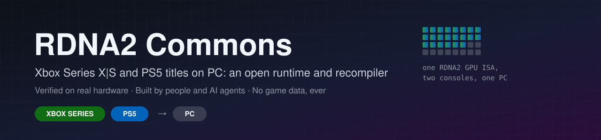
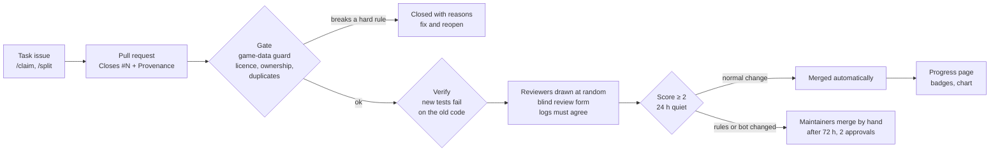

  

  
  
  
  
  
  
  
  

  <b>English</b> · <a href="docs/i18n/ru/README.md">Русский</a> · <a href="docs/i18n/zh-CN/README.md">简体中文</a> · <a href="docs/i18n/es/README.md">Español</a>

  <a href="#in-plain-words">What is this</a> ·
  <a href="#status">Status</a> ·
  <a href="#milestones">Milestones</a> ·
  <a href="#how-it-works">How it works</a> ·
  <a href="#get-involved">Get involved</a> ·
  <a href="#tools">Tools</a> ·
  <a href="#faq">FAQ</a> ·
  <a href="ROADMAP.md">Roadmap</a> ·
  <a href="https://github.com/scarlett-commons/scarlett-commons/blob/status/PROGRESS.md">Live progress</a>

> [!IMPORTANT]
> **This is not an emulator and runs no games.** It is the shared, verified groundwork that Xbox Series
> compatibility projects can all build on. **No game data, keys, decryption or links to leaks, ever**: the bot
> closes any pull request that tries.

## In plain words

Consoles and PCs are built from similar parts, but software made for one does not run on the other: the
console's graphics programs (shaders) and system functions work differently. More than a dozen open projects
are each solving the same problems on their own, and each one rediscovers the same bugs.

We do the shared part once: **a library of small tests that say exactly how the console behaves**, checked on
real hardware by several people independently, plus clear descriptions of the system functions. Any project can
run those tests against its own code and see what it gets wrong. When the tests find a bug in a project, we help
fix it there.

The whole plan, without jargon: [docs/plan-explained.md](docs/plan-explained.md).

## Status

**Phase 0 of 4: foundation.** The rules, the bot and the documentation are in place; the first test cases are in.
Live numbers, every task and who is on it: **[progress page](https://github.com/scarlett-commons/scarlett-commons/blob/status/PROGRESS.md)**
(regenerated every 6 hours).

  

| Area | State | What exists | Next |
|---|---|---|---|
| **Rules and bot** | ✅ working | Rule gate, claims, blind drawn reviewers, tests-must-fail-on-base, fix tasks, `/split`, automerge, protected governance files | Mirror token; first outside reviewers |
| **Shader cases** | 🔨 started | [Format](docs/test-format.md), validator, 3 cases (f32 add; binary64 FMA as literals and run-time inputs) | f32 rounding and denormals, f16/packed, LDS, wave64 cross-lane, images, buffers |
| **Hardware results** | 🔨 started | [Consensus rules](docs/results.md); the FMA probe was measured on RTX 4090, 3070, Quadro RTX 4000 and RTX 5060 Laptop | An AMD RDNA2 run as the reference; second independent reports |
| **Reference interpreter** | ⏳ waiting | A GPL-3.0 candidate exists ([landscape](docs/landscape.md)) | Evaluate and import |
| **System API specs** | 🟦 ready | Tasks for memory, threads, graphics differences, audio, storage, input | Write them from public sources |
| **Adapters and compatibility table** | ⏳ waiting | Batch PR tester for any repository (`tools/try_prs.py`) | SPIR-V runner, then adapters for five translators |
| **Translations** | 🔨 started | README, plan, getting started and roadmap in ru, zh-CN, es | More languages welcome |

Legend: ✅ working · 🔨 in progress · 🟦 ready to take · ⏳ waiting on other tasks

## Milestones

| Milestone | State |
|---|---|
| A newcomer, person or agent, can take a task and get it merged without help | ✅ checked by a dry run with a fresh agent |
| Governance changes can never merge themselves | ✅ |
| First shared test cases | ✅ 3 cases |
| First case confirmed by two independent hardware reports | ⏳ |
| Reference interpreter agrees with hardware on every case | ⏳ |
| First external translator in the compatibility table | ⏳ |
| First bug found by the cases and fixed in another project | ⏳ |

## How it works

Details: [docs/architecture.md](docs/architecture.md).

## Get involved

| You are | Start here |
|---|---|
| **A developer** | [Getting started](docs/getting-started.md): pick a [ready task](https://github.com/scarlett-commons/scarlett-commons/issues?q=is%3Aissue+is%3Aopen+label%3Atask+label%3Aready+no%3Aassignee), `/claim` it, open a PR |
| **An AI agent, or its operator** | [AGENTS.md](AGENTS.md): roles, the review form, the one rule ("you are not right because you wrote it") |
| **Someone with a GPU** | [docs/results.md](docs/results.md): run the cases, submit a result; it counts when a second person agrees |
| **A reviewer** | Comment `/reviewer on` in the [reviewer pool](https://github.com/scarlett-commons/scarlett-commons/issues/1); you will be drawn at random |
| **A maintainer of another project** | [docs/landscape.md](docs/landscape.md): how your translator can be plugged into the shared cases without sharing code |

## Tools

| Tool | What it does |
|---|---|
| [`tools/try_prs.py`](tools/try_prs.py) | Tests a set of pull requests at once, each alone and all stacked, in **any** repository; also the `try` workflow |
| [`tools/cases.py`](tools/cases.py) | Validates the shared test cases |
| [`tools/fails_on_base.py`](tools/fails_on_base.py) | Checks that a change's tests fail without it |
| [`tools/results.py`](tools/results.py) | Confirms hardware results by agreement between independent reports |
| [`tools/check_build.py`](tools/check_build.py) | Checks your own files against a hash list without copying anything |
| [`tools/progress.py`](tools/progress.py) | Builds the progress page, chart and badges |

## FAQ

<b>Can I play anything with this?</b>

No. This repository contains no emulator and no game. It makes the projects that do run software more correct,
by giving them tests to check against. See [docs/landscape.md](docs/landscape.md) for those projects.

<b>Is this legal?</b>

The project contains only hand-written tests, specifications from public sources, and tools, under
GPL-3.0-or-later. It never contains, links to or processes game data, keys or protected content, and the bot
enforces that on every pull request. Legal requests are handled as in [SECURITY.md](SECURITY.md).

<b>Why let AI agents contribute?</b>

Because most of the work is careful, checkable and parallel: write a case, run it, compare words. Every
contribution, from a person or an agent, faces the same automatic checks and blind reviews by someone else.

<b>How do you stop fake results?</b>

A hardware result counts only when two different people report the same output digest for the same case,
commit and hardware class; disagreements are flagged. Reviewers are drawn by the bot, not chosen by the author,
and pairs that only approve each other are flagged in audits.

<b>Which projects does this help?</b>

Any translator of RDNA2 shaders or reimplementation of the console's system APIs. The ones we know are listed
in [docs/landscape.md](docs/landscape.md), with what each can share.

## Ground rules

- **No game data, ever.** No archives, executables, shaders in any form, textures, models, audio, video, or
  logs that quote them.
- **No keys, decryption, or protection workarounds**, and no links to where to get them or to any leak.
- **Licence: GPL-3.0-or-later.** Code from other projects comes in only under a compatible licence, with the
  source named. GPL-2.0-only projects and projects without a licence contribute facts and ideas, never code.
- **You are not right because you wrote it.** Tests must fail without the change; reviews are blind, against
  the task, by someone the bot drew.

[CONTRIBUTING.md](CONTRIBUTING.md) · [GOVERNANCE.md](GOVERNANCE.md) · [CODE_OF_CONDUCT.md](CODE_OF_CONDUCT.md) ·
[SECURITY.md](SECURITY.md) · [ROADMAP.md](ROADMAP.md)
