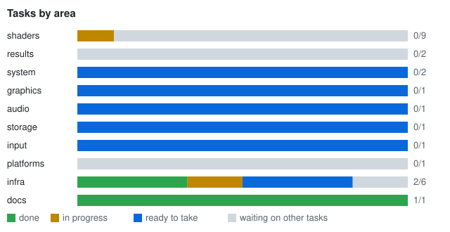

# Progress

Generated 2026-11-24 09:39 UTC from the task board by `tools/progress.py`. Do not edit by hand.

**3 of 25 tasks done** `██··················` · 2 in progress · 8 ready to take · 12 waiting on others · 3 pull requests merged by 1 contributors

## Phases

| Phase | What it means | Progress | Done |
|---|---|---|---:|
| 0. Foundation | the bot, the rules and the docs that let anyone join | `█████·····` | 3/6 |
| 1. Shared knowledge | tests that define correct behaviour, checked on real hardware | `··········` | 0/16 |
| 2. Adapters | running other projects' translators against those tests | `··········` | 0/3 |
| 3. Upstream fixes | fixing what the tests find, in the projects themselves | `··········` | 0/0 |
| 4. Shared components | pieces several projects need and nobody has yet | `··········` | 0/0 |

## Areas

| Area | Progress | Done | In progress | Ready | Waiting |
|---|---|---:|---:|---:|---:|
| shaders | `··········` | 0 | 1 | 0 | 8 |
| results | `··········` | 0 | 0 | 0 | 2 |
| system | `··········` | 0 | 0 | 2 | 0 |
| graphics | `··········` | 0 | 0 | 1 | 0 |
| audio | `··········` | 0 | 0 | 1 | 0 |
| storage | `··········` | 0 | 0 | 1 | 0 |
| input | `··········` | 0 | 0 | 1 | 0 |
| platforms | `··········` | 0 | 0 | 0 | 1 |
| infra | `███·······` | 2 | 1 | 2 | 1 |
| docs | `██████████` | 1 | 0 | 0 | 0 |

## Hardware results

No reports yet. See docs/results.md.

Take a ready task: see docs/getting-started.md.
