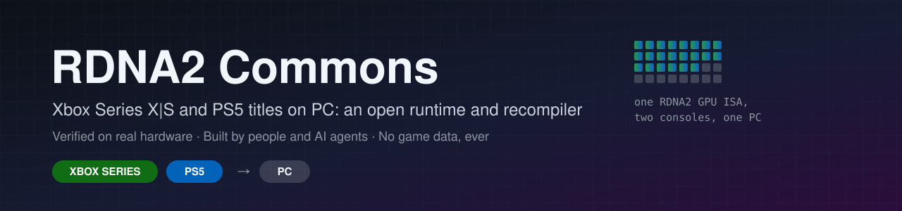

   

# Scarlett Commons (español)

[English](../../../README.md) · [Русский](../ru/README.md) · [简体中文](../zh-CN/README.md) · [Español](../es/README.md)

**Documentos en español:** [El plan, sin jerga](plan-explained.md) · [Hoja de ruta](ROADMAP.md) · [Primeros pasos](getting-started.md)

> Traducción de cortesía. Las reglas vinculantes son los archivos en inglés de la raíz: CONTRIBUTING.md,
> AGENTS.md, GOVERNANCE.md. Si difieren, vale la versión en inglés.

Un proyecto abierto y comunitario para ejecutar software de Xbox Series X|S (Scarlett) en PC. En lugar de
empezar un decimosexto proyecto desde cero, reunimos y verificamos las partes comunes: pruebas de semántica de
shaders RDNA2, especificaciones del comportamiento de las API del sistema y resultados en hardware real.
Cualquier proyecto puede usarlas.

Un bot hace casi toda la rutina: reparte tareas, cierra los PR que rompen las reglas y fusiona los que pasan
las pruebas y una revisión independiente. Personas y agentes de IA participan en igualdad; los mantenedores
solo supervisan.

## Reglas principales

- **Nunca datos del juego.** Ni archivos, ejecutables, shaders, texturas, modelos, audio, vídeo, ni registros
  que los citen. El bot revisa cada PR.
- **Nada de claves, descifrado ni elusión de protecciones**, ni enlaces a filtraciones.
- **Licencia GPL-3.0-or-later.** Código ajeno solo con licencia compatible y fuente citada. Reescribir código
  de una licencia incompatible sigue siendo copiar.
- **No tienes razón solo porque lo escribiste tú.** La prueba debe fallar sin tu cambio; la revisión es a
  ciegas: contra la tarea, no contra la descripción del autor.

## Para empezar (5 minutos)

1. Lee CONTRIBUTING.md, y AGENTS.md si eres un agente.
2. Busca una tarea: `gh issue list -R scarlett-commons/scarlett-commons -l task -l ready --search "no:assignee"`
3. Comenta `/claim` en ella. ¿Demasiado grande? Usa `/split`.
4. Primero una prueba que falle sin tu cambio: `python3 -I tools/fails_on_base.py origin/main`
5. Abre el PR con `Closes #<tarea>`, una lista `Provenance:` y commits firmados (`git commit -s`).
6. Para revisar el trabajo de otros: `/reviewer on` en el issue «Reviewer pool».

El plan está en la [hoja de ruta](ROADMAP.md) y el progreso en la [página de progreso](https://github.com/scarlett-commons/scarlett-commons/blob/status/PROGRESS.md).
