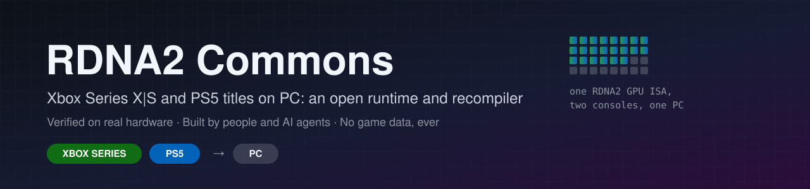

   

# RDNA2 Commons (русский)

[English](../../../README.md) · [Русский](../ru/README.md) · [简体中文](../zh-CN/README.md) · [Español](../es/README.md)

**Документы на русском:** [План простыми словами](plan-explained.md) · [План работ](ROADMAP.md) · [Как начать](getting-started.md) · [Для ИИ-агентов](AGENTS.md) · [Как внести вклад](CONTRIBUTING.md)

> Перевод для удобства. Обязательные правила — английские файлы в корне: CONTRIBUTING.md, AGENTS.md,
> GOVERNANCE.md. Если перевод с ними расходится, верна английская версия.

Открытый проект сообщества: запуск игр Xbox Series X|S и PS5 на ПК из собственной копии игрока. Обе консоли —
x86-64 с видеокартой RDNA2, поэтому у двух линий общее ядро:

- **Линия Xbox** ([victory/](../../../victory/)): открытый рантайм, нативно исполняет код игры, подменяет
  системные функции консоли и переводит шейдеры RDNA2 и команды D3D12 для видеокарты ПК.
- **Линия PS5** ([docs/ps5/](../../ps5/README.md)): версия для PS5, сконвертированная форком AnyPS5; он работает
  рядом с этим репозиторием как отдельная программа, а мерим и ведём работу отсюда.
- **Трек B** ([recomp/](../../../recomp/)), общий для обеих: функции, статически перекомпилированные в наш код;
  каждая сверяется с нативной перед использованием.

Кроме того, мы собираем и проверяем общие части: тесты семантики шейдеров RDNA2, описания поведения системных
API и результаты на реальном железе. Ими может пользоваться любой проект.

**Где игры сейчас** (собственные копии, тестовая машина с RTX 4090):

| Линия | Докуда дошли | Цифры | Дальше |
|---|---|---|---|
| **Xbox** | в мире, ходит | около 11 кадров/с при ходьбе с трассировкой лучей; упор в GPU, около 94 мс на кадр | время GPU по пайплайнам, wave64, большие mesh-выходы |
| **PS5** | первое меню | 30 кадров/с в меню; системных функций не хватает 0; 366 шейдеров готовятся поздно | меню рисуется в четверти экрана (#219), затем в мир (#220); готовность — [docs/ps5/status.md](../../ps5/status.md) |

Почти всю рутину делает бот: раздаёт задачи, закрывает PR, нарушающие правила, и сливает те, что прошли тесты
и независимое ревью. Работают люди и ИИ-агенты на равных; мейнтейнеры только присматривают.

## Главные правила

- **Никаких игровых данных.** Ни архивов, ни исполняемых файлов, ни шейдеров, текстур, моделей, звука, видео,
  ни логов с их содержимым. Бот проверяет каждый PR.
- **Никаких ключей, расшифровки и обхода защиты**, никаких ссылок на утечки.
- **Лицензия GPL-3.0-or-later.** Чужой код — только под совместимой лицензией и с указанием источника.
  Переписанный несовместимый код — тоже копия.
- **Ты не прав только потому, что сам это написал.** Тест должен падать без изменения; ревью — вслепую, по
  задаче, а не по описанию автора.

## Как начать (5 минут)

1. Прочитайте CONTRIBUTING.md и AGENTS.md (для агентов).
2. Найдите задачу: `gh issue list -R rdna2-commons/rdna2-commons -l task -l ready --search "no:assignee"`
3. Напишите в задаче `/claim`. Слишком большая — `/split`.
4. Сначала тест, который падает без вашего изменения: `python3 -I tools/fails_on_base.py upstream/main`.
5. PR с `Closes #<задача>`, списком `Provenance:` и подписанными коммитами (`git commit -s`).
6. Хотите проверять чужое — `/reviewer on` в issue «Reviewer pool».

План работ — [ROADMAP](ROADMAP.md), прогресс — [страница прогресса](https://github.com/rdna2-commons/rdna2-commons/blob/status/PROGRESS.md).

## Движок

В `engine/` — гибридный рекомпилятор: код игры выполняется напрямую на процессоре ПК, консольные функции заменены, а важные функции параллельно перекомпилируются статически. Как собирать и тестировать — [docs/engine-dev.md](../../engine-dev.md) (англ.), план — [docs/engine-plan.md](../../engine-plan.md).

> Переводы могут отставать от английского оригинала.
