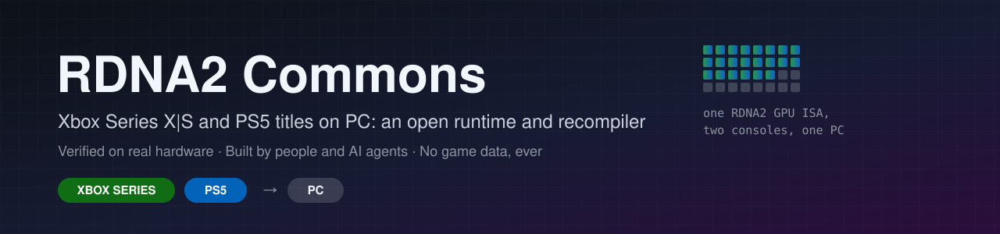

   

# Scarlett Commons（简体中文）

[English](../../../README.md) · [Русский](../ru/README.md) · [简体中文](../zh-CN/README.md) · [Español](../es/README.md)

**中文文档：** [计划（大白话）](plan-explained.md) · [路线图](ROADMAP.md) · [快速开始](getting-started.md)

> 本译文仅为方便阅读。具有约束力的规则以根目录的英文文件为准：CONTRIBUTING.md、AGENTS.md、GOVERNANCE.md。

一个由社区运营的开放项目：让 Xbox Series X|S（Scarlett）软件在 PC 上运行。我们不再从零开始做第十六个项目，
而是汇集并验证各项目共用的部分：RDNA2 着色器语义测试、系统 API 行为规范，以及在真实硬件上得到的结果。
任何项目都可以使用。

日常事务大多由机器人完成：分配任务、关闭违反规则的 PR、合并通过测试和独立评审的 PR。
人类和 AI 代理地位相同；维护者只负责监督。

## 核心规则

- **绝不包含游戏数据。** 不得提交存档包、可执行文件、着色器、纹理、模型、音频、视频，或引用这些内容的日志。
  机器人会检查每个 PR。
- **不得包含密钥、解密或绕过保护的内容**，也不得链接到任何泄露内容。
- **许可证：GPL-3.0-or-later。** 外部代码必须使用兼容许可证并注明来源。改写不兼容许可证的代码仍属于复制。
- **代码是你写的，并不代表它是对的。** 测试必须在没有你的改动时失败；评审要“盲审”：对照任务，而不是作者的描述。

## 快速开始（5 分钟）

1. 阅读 CONTRIBUTING.md，代理请阅读 AGENTS.md。
2. 找任务：`gh issue list -R scarlett-commons/scarlett-commons -l task -l ready --search "no:assignee"`
3. 在任务下评论 `/claim`。任务太大就用 `/split` 拆分。
4. 先写一个没有你的改动就会失败的测试：`python3 -I tools/fails_on_base.py origin/main`
5. 提交 PR，写明 `Closes #<任务号>`、`Provenance:` 来源列表，并签署提交（`git commit -s`）。
6. 想参与评审：在 “Reviewer pool” issue 中评论 `/reviewer on`。

工作计划见 [路线图](ROADMAP.md)，进度见[进度页](https://github.com/scarlett-commons/scarlett-commons/blob/status/PROGRESS.md)。
