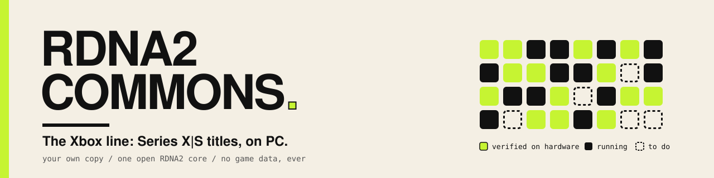

# The Xbox line

The Xbox Series X|S build of a title, run on PC from the player's own copy. Nothing of a title goes into this
repository.

| Part | Where | Read |
|---|---|---|
| Runtime: loads the title's code natively, stands in for the console's system functions, translates RDNA2 shaders and D3D12 command lists | [`victory/`](../victory/) | [nvidia.md](nvidia.md) for NVIDIA cards |
| Track B: functions statically recompiled into our own code, each checked against the native code | [`recomp/`](../recomp/) | [track-b.md](track-b.md) |
| The engine track: the Leonida recompiler, followed automatically | [`engine/`](../engine/README.md) | [engine-plan.md](engine-plan.md) |

## Where it is

In the world, walking, with ray-traced light: about 11 fps walking on an RTX 4090. The GPU is the limit, at
about 94 ms a frame. Open work: GPU time per pipeline, compute shaders that need wave64 on NVIDIA, mesh shaders
whose output is over 32 KB, and heap descriptors changed inside a frame being seen a frame late.

The PS5 line has priority today ([ps5/plan.md](ps5/plan.md)); the Xbox line continues alongside it.
